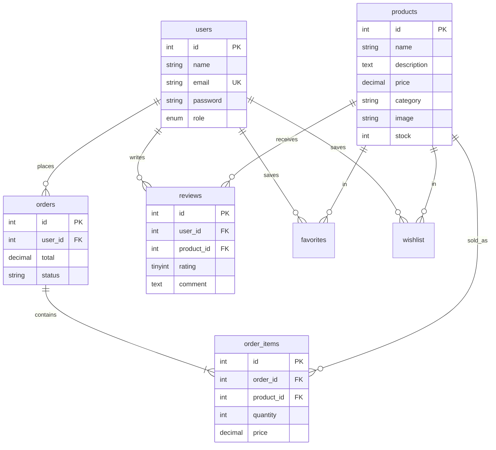

<div align="center">

# 🛒 Store — Full-Stack E-Commerce Application

A complete online store with a REST API, MySQL database, role-based authentication, and an admin dashboard.


</div>

---

## 📸 Screenshots

> Add your screenshots to a `screenshots/` folder and update the paths below.

| Storefront (dark) | Storefront (light) |
|---|---|
|  |  |

| Product details & reviews | Admin dashboard |
|---|---|
|  |  |

---

## ✨ Features

**Shopping experience**
- Product catalog with **real-time search**, category filter, and sorting (newest, price, top rated)
- **Grid / list view toggle** and **dark / light mode** (preferences are remembered)
- Product details with photos, stock levels, and **star-rating reviews**
- **Favorites** and **wishlist** for logged-in users
- Shopping cart saved in the browser, with a checkout and order history

**Accounts & security**
- Register / login with **JWT** authentication
- Passwords hashed with **bcrypt**
- **Role-based access control**: `user` and `admin`
- Server-side validation of prices, stock, and ratings (the client is never trusted)
- Output escaping on the frontend to prevent XSS

**Admin dashboard**
- Full product **CRUD** (create, read, update, delete)
- Image upload with **Multer** (type and size limited) or image URL
- Overview of all customer orders

**Reliable checkout**
- Orders are created inside a **MySQL transaction** with row locking (`SELECT ... FOR UPDATE`), so two customers can never buy the same last item
- If any item is out of stock, the whole order is rolled back

> 💳 **Note:** the payment form is a demo UI. No real card data is collected, charged, or stored. The checkout is structured so a payment provider such as Stripe can be added at the order-creation step.

---

## 🧰 Tech Stack

| Layer | Technology |
|---|---|
| Backend | Node.js, Express |
| Database | MySQL (`mysql2` with connection pool) |
| Auth | JSON Web Tokens, bcryptjs |
| File uploads | Multer |
| Frontend | HTML, CSS (CSS variables for theming), vanilla JavaScript |

---

## 🚀 Getting Started

### Prerequisites
- [Node.js](https://nodejs.org) 18 or newer
- [MySQL](https://dev.mysql.com/downloads/) 8 (running locally)

### Installation

```bash
# 1. Clone the repository
git clone https://github.com/ritamagdy22/E-commerce-Website-Nodejs-MySQl.git
cd E-commerce-Website-Nodejs-MySQl

# 2. Install dependencies
npm install

# 3. Create your environment file
cp .env.example .env        # on Windows: copy .env.example .env
```

Open `.env` and set your values:

```env
PORT=3000
DB_HOST=localhost
DB_USER=root
DB_PASSWORD=your_mysql_password
DB_NAME=store_db
JWT_SECRET=change_this_to_a_long_random_string
ADMIN_EMAIL=admin@store.com
ADMIN_PASSWORD=Admin123!
```

```bash
# 4. Create the database, tables, admin account, and sample products
npm run setup

# 5. Start the server
npm start
```

Open **http://localhost:3000** 🎉

### Admin access
Log in with the `ADMIN_EMAIL` and `ADMIN_PASSWORD` from your `.env` (default `admin@store.com` / `Admin123!`). An **Admin** button appears in the header and opens the dashboard.

---

## 🗂 Project Structure

```
├── server.js          # Express app: routes, auth middleware, validation
├── setup.js           # Creates database, tables, admin user, sample products
├── db.js              # MySQL connection pool
├── public/
│   ├── index.html     # Storefront
│   ├── admin.html     # Admin dashboard
│   ├── app.js         # Storefront logic (cart, search, reviews, checkout)
│   ├── common.js      # Shared helpers (API client, theme, toasts)
│   └── style.css      # Styles with light/dark themes
├── uploads/           # Images uploaded from the admin panel
├── .env.example       # Environment variable template
└── package.json
```

---

## 🗄 Database Schema



---

## 🔌 API Reference

| Method | Endpoint | Access | Description |
|---|---|---|---|
| POST | `/api/auth/register` | Public | Create an account |
| POST | `/api/auth/login` | Public | Log in, receive a JWT |
| GET | `/api/products?q=&category=&sort=` | Public | Search, filter, and sort products |
| GET | `/api/categories` | Public | List categories |
| GET | `/api/products/:id/reviews` | Public | Reviews for a product |
| POST | `/api/products/:id/reviews` | User | Add or update your review (1–5) |
| POST | `/api/products` | Admin | Create a product (multipart, optional image) |
| PUT | `/api/products/:id` | Admin | Update a product |
| DELETE | `/api/products/:id` | Admin | Delete a product |
| GET / POST | `/api/favorites`, `/api/favorites/:productId` | User | List / toggle favorites |
| GET / POST | `/api/wishlist`, `/api/wishlist/:productId` | User | List / toggle wishlist |
| POST | `/api/orders` | User | Place an order (transactional) |
| GET | `/api/orders` | User / Admin | Own orders, or all orders for admins |

Protected routes expect the header `Authorization: Bearer <token>`.

---

## 🛠 Troubleshooting

| Problem | Fix |
|---|---|
| `Access denied for user 'root'@'localhost' (using password: NO)` | The `.env` file is missing or `DB_PASSWORD` is empty. Copy `.env.example` to `.env` and add your MySQL password. |
| `ECONNREFUSED` | MySQL isn't running. Start the MySQL service. |
| `EADDRINUSE ... port 3000` | Another server is already using the port. Stop it, or set `PORT=3001` in `.env`. |
| Empty store page | Run `npm run setup` once to create the tables and sample products. |

---

## Admin dashboard
On the store page, click Log in and sign in with admin@store.com / Admin123!, or the ADMIN_EMAIL and ADMIN_PASSWORD from your .env.
An Admin button will appear in the header next to Log in. Click it, or go straight to the address above. 
http://localhost:3000/admin.html.

---


https://github.com/user-attachments/assets/38413fb9-570e-4b65-b582-1d711df46544


## 👩‍💻 Author

**Rita Magdy** — aspiring backend engineer

[](https://www.linkedin.com/in/rita-magdy-033054268/)
[](https://github.com/ritamagdy22)

---

<div align="center">⭐ If you found this project useful, consider giving it a star!</div>
